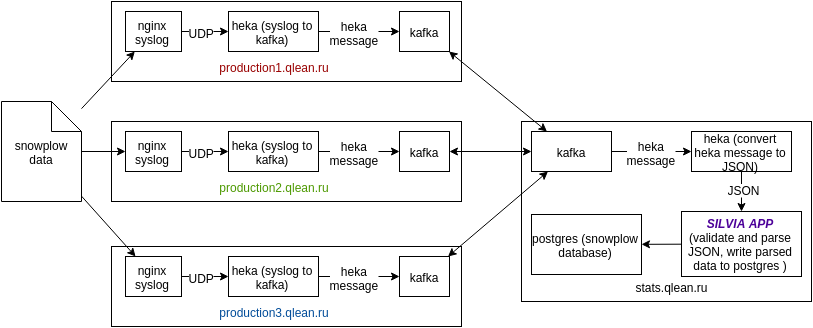

# Silvia
Transforms analytics trackers data (Snowplow and Adjust) and writes it to PostgreSQL.

## Dependencies

- Nginx version > 1.7.1 (with syslog support)
- [Mozilla's Heka](https://github.com/mozilla-services/heka) (With SysLog inputs, decoders and AMQP Outputs)
- RabbitMQ (with "snowplow" and "adjust" queues and exchanges)
- Consul (for configuration)
- PostgreSQL (events strorage)

## Deployment map

## App structure

