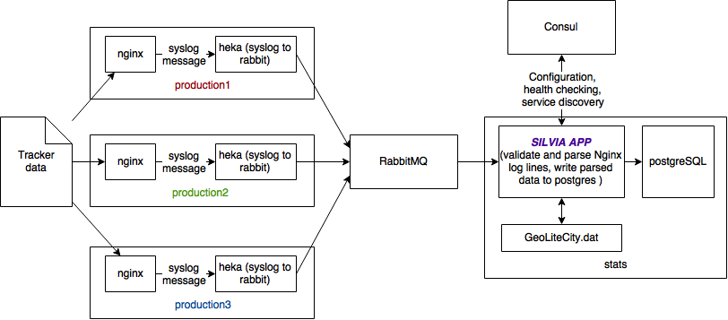
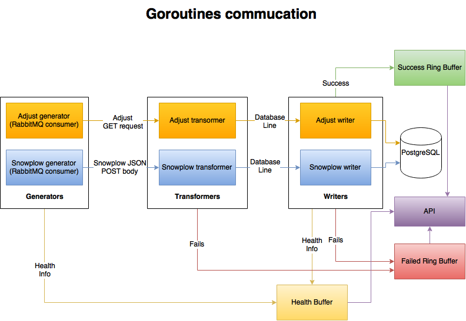

# Silvia
Transforms analytics trackers data (Snowplow and Adjust) and writes it to PostgreSQL.

## Dependencies

- Nginx version > 1.7.1 (with syslog support)
- [Mozilla's Heka](https://github.com/mozilla-services/heka) (With SysLog inputs, decoders and AMQP Outputs)
- RabbitMQ (with "snowplow" and "adjust" queues and exchanges)
- Consul (for configuration, health checking and service discovery)
- PostgreSQL (events strorage)
- `GeoLiteCity.dat` database file in same folder with application

## Configuration

You're should provide following keys in consul Key-Value storage:

- `silvia/pg_connect` - PostgreSQL connection configuration (e.g. `dbname=analytics host=postgres user=postgres password=secretpass`)
- `silvia/port` - API port binding
- `silvia/rabbit_addr` - RabbitMQ address
- `silvia/rabbit_addr` - RabbitMQ port
- `silvia/ring_size` - Ring buffers size (e.g. `10`)

## Deployment

## App structure

## API endpoints

`/v1/status` - Application summary statistics. Returns `200` if healthy, `429` if not.

`/v1/ring?tracker=TRACKER_NAME&ring=RINGNAME` - Display particular ring buffer. Parameters: tracker (`snowplow` or `adjust`), ring (`success` or `failed`)
